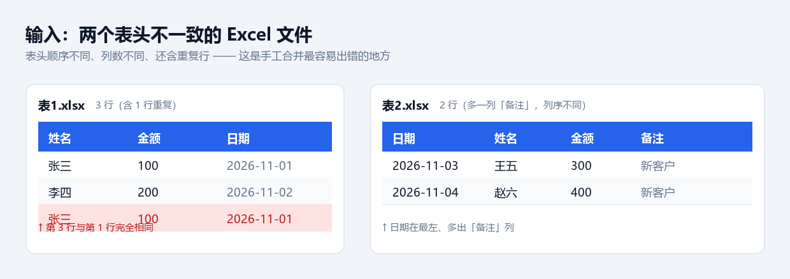

# Excel 批量合并工具 (excel_merger)

把文件夹里的一堆 Excel 文件，一键合并成一个，支持去重、对齐表头、标记来源文件、输出 xlsx 或 csv。


## 功能
- 批量合并 `.xlsx` / `.xls`
- 自动对齐不同文件的表头（取并集）
- 可选去除完全重复的行
- 每行自动追加「来源文件」列，方便溯源
- 输出 Excel 或 CSV

## 环境要求
- Python 3.8+
- 依赖：`pip install openpyxl`

## 快速开始

```bash
# 合并 folder 下所有 Excel，输出到 merged.xlsx
python excel_merger.py "D:\待合并表格" -o merged.xlsx

# 去重 + 输出 csv
python excel_merger.py "D:\待合并表格" -o merged.csv --dedup

# 指定工作表名 + 打印处理过程
python excel_merger.py "D:\待合并表格" -o merged.xlsx --sheet "Sheet1" --verbose
```

## 参数说明
| 参数 | 说明 |
|---|---|
| `folder` | 输入文件夹（位置参数） |
| `-o / --output` | 输出文件，`.xlsx` 或 `.csv` |
| `--sheet` | 指定工作表名（默认第一个） |
| `--dedup` | 去除完全重复的行 |
| `--verbose` | 打印每个文件处理情况 |

## 实际运行效果

### 1. 输入：两个表头不一致的文件



`表1.xlsx` 的表头是「姓名 / 金额 / 日期」，含一行重复数据；
`表2.xlsx` 的表头是「日期 / 姓名 / 金额 / 备注」，列序不同还多一列。

### 2. 一条命令完成合并


```bash
python excel_merger.py 测试数据 -o 合并结果.xlsx --dedup --verbose
```

### 3. 输出：表头对齐 + 去重 + 来源标注


- 表头自动取并集对齐，`表2` 多出的「备注」列自动补上
- `表1` 里重复的「张三 100 2026-11-01」只保留一行
- 每行末尾标注来自哪个文件

## 示例
假设 `D:\销售数据` 下有 3 个文件，表头不完全一致：
```bash
python excel_merger.py "D:\销售数据" -o 汇总.xlsx --dedup
```
输出一个 `汇总.xlsx`，所有行合并，重复行去掉，最后一列标出每行来自哪个文件。

## License
MIT
